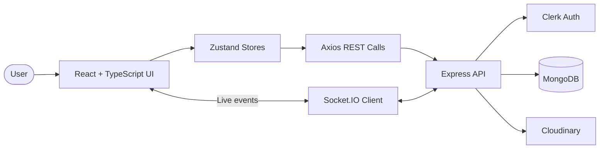

<div align="center">

# 🎧 Spotify — Music & Social Listening

**A Spotify-inspired full-stack music experience with real-time chat, live activity, and an admin dashboard.**

Built with React · TypeScript · Express · MongoDB · Socket.IO

<p>
  
  
  
  
  
</p>

[Explore the Code](https://github.com/Shivainfinity12/Spotify) · [Report an Issue](https://github.com/Shivainfinity12/Spotify/issues)

</div>

---

> An independent learning project inspired by modern music-streaming experiences. It is **not affiliated with, endorsed by, or sponsored by Spotify**.

## ✨ What makes it special?

<table>
  <tr>
    <td width="50%">
      <h3>🎵 Music Player</h3>
      Explore featured, trending, and “Made for you” tracks. Browse albums and control playback with a shared queue.
    </td>
    <td width="50%">
      <h3>💬 Real-Time Chat</h3>
      Send messages to other users, see online presence, and receive live updates through Socket.IO.
    </td>
  </tr>
  <tr>
    <td width="50%">
      <h3>🟢 Listening Activity</h3>
      Share the current listening activity with connected users, bringing a social layer to the music experience.
    </td>
    <td width="50%">
      <h3>🛠️ Admin Dashboard</h3>
      Manage songs and albums, upload media, and view platform statistics through protected admin routes.
    </td>
  </tr>
</table>

## 🚀 Feature Highlights

- **Music discovery:** Featured, trending, and “Made for you” sections.
- **Album browsing:** Album detail pages with track listings and playback actions.
- **Playback controls:** Play, pause, next, previous, and queue management.
- **Authentication:** Clerk-powered sign-in integration.
- **Live messaging:** Socket.IO events with messages persisted in MongoDB.
- **Presence and activity:** Online users and listening activity updates.
- **Media uploads:** Cloudinary integration for audio and cover images.
- **Admin tools:** Song/album management and statistics.
- **Responsive layout:** Multi-panel interface with navigation, content, activity, and player controls.

## 🧰 Tech Stack

| Layer | Technologies |
|---|---|
| Frontend | React 19, TypeScript, Vite, React Router |
| Styling & UI | Tailwind CSS 4, shadcn/ui components, Base UI, Lucide React |
| State management | Zustand |
| HTTP & notifications | Axios, React Hot Toast |
| Authentication | Clerk |
| Backend | Node.js, Express 5 |
| Database | MongoDB, Mongoose |
| Real-time | Socket.IO |
| Media storage | Cloudinary |

## 🏗️ How It Works



- **REST API** handles music, albums, users, admin operations, and statistics.
- **MongoDB** stores application records, including songs, albums, users, and chat messages.
- **Socket.IO** handles real-time messaging, online presence, and user activity.
- **Clerk** provides authentication; admin access is checked against the configured `ADMIN_EMAIL`.
- **Cloudinary** stores media uploaded through the admin tools.

## 📁 Project Structure

```text
Spotify/
├── package.json
├── frontend/
│   ├── package.json
│   ├── vite.config.ts
│   └── src/
│       ├── App.tsx
│       ├── main.tsx
│       ├── components/
│       ├── layout/
│       ├── pages/
│       │   ├── home/
│       │   ├── album/
│       │   ├── chat/
│       │   ├── admin/
│       │   └── auth-callback/
│       ├── providers/
│       └── stores/
└── backend/
    ├── package.json
    └── src/
        ├── index.js
        ├── controllers/
        ├── routes/
        ├── middleware/
        ├── models/
        ├── libs/
        └── seeds/
```

## ⚡ Run It Locally

### Requirements

- [Node.js](https://nodejs.org/) and npm
- [MongoDB](https://www.mongodb.com/) database
- [Clerk](https://clerk.com/) application keys
- [Cloudinary](https://cloudinary.com/) account for admin media uploads

### 1. Clone the repository

```bash
git clone https://github.com/Shivainfinity12/Spotify.git
cd Spotify
```

### 2. Add backend environment variables

Create `backend/.env`:

```dotenv
PORT=5000
NODE_ENV=development
MONGO_URI=your_mongodb_connection_string
CLERK_SECRET_KEY=your_clerk_secret_key
ADMIN_EMAIL=you@example.com
CLOUDINARY_CLOUD_NAME=your_cloud_name
CLOUDINARY_API_KEY=your_cloudinary_api_key
CLOUDINARY_API_SECRET=your_cloudinary_api_secret
```

### 3. Add the frontend key

Create `frontend/.env`:

```dotenv
VITE_CLERK_PUBLISHABLE_KEY=your_clerk_publishable_key
```

Use your own credentials. **Never commit `.env` files or real secrets.**

### 4. Install dependencies

Run these commands from the repository root:

```bash
npm install
npm install --prefix backend
npm install --prefix frontend
```

### 5. Start the backend

In terminal 1:

```bash
cd backend
npm run dev
```

By default, the backend listens on `http://localhost:5000`.

### 6. Start the frontend

In terminal 2:

```bash
cd frontend
npm run dev
```

Open **[http://localhost:3000](http://localhost:3000)**.

> **Local setup note:** The backend and Socket.IO currently allow the frontend origin `http://localhost:3000`. If you change ports or deploy to a different domain, update both CORS configurations.

## 🔐 Environment Variables

| Variable | Used by | Purpose |
|---|---|---|
| `PORT` | Backend | Server port; defaults to `5000` |
| `NODE_ENV` | Backend | Enables production static-file serving when set to `production` |
| `MONGO_URI` | Backend | MongoDB connection string |
| `CLERK_SECRET_KEY` | Backend | Server-side Clerk integration |
| `ADMIN_EMAIL` | Backend | Email address authorized for admin routes |
| `CLOUDINARY_CLOUD_NAME` | Backend | Cloudinary cloud name |
| `CLOUDINARY_API_KEY` | Backend | Cloudinary API key |
| `CLOUDINARY_API_SECRET` | Backend | Cloudinary API secret |
| `VITE_CLERK_PUBLISHABLE_KEY` | Frontend | Clerk key used by the browser application |

Only values intended to be exposed in the browser should use Vite's `VITE_` prefix. Keep secret keys on the backend.

## 📜 Useful Commands

### Root

| Command | What it does |
|---|---|
| `npm run build` | Installs frontend/backend dependencies and builds the frontend |
| `npm start` | Starts the backend |

### Frontend — run inside `frontend/`

| Command | What it does |
|---|---|
| `npm run dev` | Starts the Vite development server |
| `npm run build` | Runs the TypeScript project build and creates the production bundle |
| `npm run lint` | Runs ESLint |
| `npm run preview` | Previews the built frontend locally |

### Backend — run inside `backend/`

| Command | What it does |
|---|---|
| `npm run dev` | Starts the backend with Nodemon |
| `npm start` | Starts the backend with Node.js |
| `npm run seed:songs` | Runs the song seed script |
| `npm run seed:albums` | Runs the album seed script |

⚠️ **Database warning:** Review the album seed script before running it on a database containing data you care about. The current script deletes existing album and song documents before inserting its sample data.

## 🔌 API At a Glance

All REST endpoints are mounted under `/api`.

| Method | Endpoint | Purpose |
|---|---|---|
| `GET` | `/api/songs` | List songs — admin access |
| `GET` | `/api/songs/featured` | Fetch featured songs |
| `GET` | `/api/songs/made-for-you` | Fetch a randomized selection |
| `GET` | `/api/songs/trending` | Fetch a randomized selection |
| `GET` | `/api/albums` | List albums |
| `GET` | `/api/albums/:albumId` | Fetch an album and its songs |
| `POST` | `/api/auth/callback` | Synchronize the application user after authentication |
| `GET` | `/api/users` | List other users — authentication required |
| `GET` | `/api/users/messages/:userId` | Fetch a conversation — authentication required |
| `GET` | `/api/admin/check` | Check admin access |
| `POST` | `/api/admin/songs` | Create a song and upload media — admin |
| `DELETE` | `/api/admin/songs/:id` | Delete a song — admin |
| `POST` | `/api/admin/albums` | Create an album — admin |
| `DELETE` | `/api/admin/albums/:id` | Delete an album — admin |
| `GET` | `/api/stats` | Fetch dashboard statistics — admin |

Real-time chat and presence are handled by Socket.IO events rather than REST endpoints.

## 🚢 Production Build

Build the frontend from the repository root:

```bash
npm run build
```

When `NODE_ENV=production`, the backend serves the built frontend from `frontend/dist`. Configure all backend environment variables and build the frontend before starting the production server.

A verified public demo URL was not available during this repository review.

## 🧭 Current Scope & Possible Next Steps

**Current implementation notes**
- The “Featured,” “Made for you,” and “Trending” endpoints select randomized songs; they are not a personalized recommendation engine.
- CORS and Socket.IO origins are configured for local development.
- Automated test scripts were not found in the inspected package manifests.
- A live deployment URL has not been verified.

**Ideas for future iterations**
- Search, saved playlists, and personalized recommendations.
- Automated tests for API routes, authentication, playback, and chat.
- Environment-based CORS configuration for deployment.
- Stronger request validation, structured logging, and error handling.
- CI checks for linting, type checking, and production builds.
- Real screenshots and a verified live demo.

## 🤝 Contributing

Contributions and constructive feedback are welcome.

1. Fork the repository.
2. Create a branch: `git checkout -b feat/your-feature`.
3. Make your changes and test them.
4. Commit: `git commit -m "feat: describe your change"`.
5. Push your branch and open a pull request.

## 📄 License

The root `package.json` declares the ISC license. Check that this matches your intended licensing and add a root `LICENSE` file if appropriate.

## 👨‍💻 Author

<div align="center">

### Shiva Infinity

[](https://github.com/Shivainfinity12)

[View Repository](https://github.com/Shivainfinity12/Spotify)

</div>
