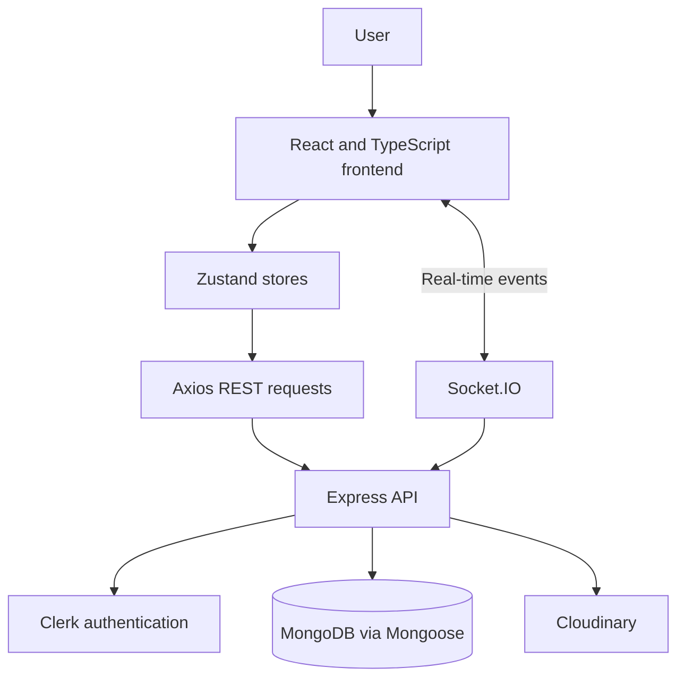

# Spotify — Music Streaming & Social Listening

A Spotify-inspired full-stack music application built with React, TypeScript, Express, MongoDB, and Socket.IO. Explore featured and trending tracks, browse albums, control playback, and connect with other users through real-time chat and activity updates.

> Independent learning project inspired by music-streaming interfaces. Not affiliated with Spotify.

## Features

- Music home page with featured, “Made for you,” and trending song sections.
- Album pages, track listings, playback queue, and play/pause/next/previous controls.
- Clerk authentication and protected admin routes.
- Admin dashboard for managing songs and albums, uploading media, and viewing statistics.
- MongoDB persistence for songs, albums, users, and messages.
- Cloudinary media uploads.
- Real-time chat, online presence, and activity updates through Socket.IO.
- Responsive multi-panel interface.

## Tech Stack

| Area | Technologies |
|---|---|
| Frontend | React 19, TypeScript, Vite, React Router |
| UI | Tailwind CSS 4, shadcn/ui components, Base UI, Lucide React |
| State and HTTP | Zustand, Axios, React Hot Toast |
| Authentication | Clerk |
| Backend | Node.js, Express 5 |
| Database | MongoDB, Mongoose |
| Real time | Socket.IO |
| Media | Cloudinary |

## Architecture



## Project Structure

```text
Spotify/
├── package.json
├── frontend/
│   ├── package.json
│   ├── vite.config.ts
│   └── src/
│       ├── App.tsx
│       ├── main.tsx
│       ├── components/
│       ├── layout/
│       ├── pages/
│       │   ├── home/
│       │   ├── album/
│       │   ├── chat/
│       │   ├── admin/
│       │   └── auth-callback/
│       ├── providers/
│       └── stores/
└── backend/
    ├── package.json
    └── src/
        ├── index.js
        ├── controllers/
        ├── routes/
        ├── middleware/
        ├── models/
        ├── libs/
        └── seeds/
```

## Prerequisites

- Node.js and npm
- MongoDB (local or hosted)
- A Clerk application
- A Cloudinary account for admin media uploads

## Getting Started

### 1. Clone the repository

```bash
git clone https://github.com/Shivainfinity12/Spotify.git
cd Spotify
```

### 2. Configure the backend

Create `backend/.env`:

```dotenv
PORT=5000
NODE_ENV=development
MONGO_URI=mongodb_connection_string
CLERK_SECRET_KEY=your_clerk_secret_key
ADMIN_EMAIL=admin@example.com
CLOUDINARY_CLOUD_NAME=your_cloud_name
CLOUDINARY_API_KEY=your_cloudinary_api_key
CLOUDINARY_API_SECRET=your_cloudinary_api_secret
```

### 3. Configure the frontend

Create `frontend/.env`:

```dotenv
VITE_CLERK_PUBLISHABLE_KEY=your_clerk_publishable_key
```

Use your own service credentials. Never commit real secrets.

### 4. Install dependencies

From the repository root:

```bash
npm install
npm install --prefix backend
npm install --prefix frontend
```

### 5. Run the application

Start the backend in one terminal:

```bash
cd backend
npm run dev
```

Start the frontend in another terminal:

```bash
cd frontend
npm run dev
```

Open http://localhost:3000. The backend defaults to http://localhost:5000.

> The backend and Socket.IO CORS settings currently allow http://localhost:3000. Update them before using a different frontend origin or deploying the services separately.

## Environment Variables

| Variable | Location | Purpose |
|---|---|---|
| PORT | Backend | HTTP port; defaults to 5000 |
| NODE_ENV | Backend | Enables production static-file serving when set to production |
| MONGO_URI | Backend | MongoDB connection string |
| CLERK_SECRET_KEY | Backend | Clerk server-side authentication |
| ADMIN_EMAIL | Backend | Email allowed to use admin routes |
| CLOUDINARY_CLOUD_NAME | Backend | Cloudinary cloud name |
| CLOUDINARY_API_KEY | Backend | Cloudinary API key |
| CLOUDINARY_API_SECRET | Backend | Cloudinary API secret |
| VITE_CLERK_PUBLISHABLE_KEY | Frontend | Clerk browser publishable key |

Only frontend variables intended to be exposed in the browser should use the `VITE_` prefix.

## Available Scripts

### Root

| Command | Purpose |
|---|---|
| `npm run build` | Installs backend and frontend dependencies, then builds the frontend |
| `npm start` | Starts the backend |

### Frontend

Run from `frontend/`.

| Command | Purpose |
|---|---|
| `npm run dev` | Starts Vite |
| `npm run build` | Runs TypeScript project builds and builds the frontend |
| `npm run lint` | Runs ESLint |
| `npm run preview` | Previews the production build locally |

### Backend

Run from `backend/`.

| Command | Purpose |
|---|---|
| `npm run dev` | Starts the backend with Nodemon |
| `npm start` | Starts the backend with Node.js |
| `npm run seed:songs` | Runs the song seed script |
| `npm run seed:albums` | Runs the album seed script |

**Warning:** Inspect the seed scripts before running them against existing data. The album seed script deletes existing album and song documents before inserting sample data.

## API Overview

All REST routes below are mounted under `/api`.

| Method | Endpoint | Purpose | Access |
|---|---|---|---|
| GET | `/api/songs` | List songs | Admin |
| GET | `/api/songs/featured` | Fetch featured songs | Public |
| GET | `/api/songs/made-for-you` | Fetch a randomized song selection | Public |
| GET | `/api/songs/trending` | Fetch a randomized song selection | Public |
| GET | `/api/albums` | List albums | Public |
| GET | `/api/albums/:albumId` | Fetch an album and its songs | Public |
| POST | `/api/auth/callback` | Synchronize the application user after authentication | Callback |
| GET | `/api/users` | List other users | Authenticated |
| GET | `/api/users/messages/:userId` | Fetch messages exchanged with a user | Authenticated |
| GET | `/api/admin/check` | Check admin access | Admin |
| POST | `/api/admin/songs` | Create a song and upload media | Admin |
| DELETE | `/api/admin/songs/:id` | Delete a song | Admin |
| POST | `/api/admin/albums` | Create an album | Admin |
| DELETE | `/api/admin/albums/:id` | Delete an album | Admin |
| GET | `/api/stats` | Fetch dashboard statistics | Admin |

Admin access requires an authenticated Clerk user whose email matches `ADMIN_EMAIL`. Chat messages and presence updates use Socket.IO events.

## Build and Production

Build the frontend from the repository root:

```bash
npm run build
```

When `NODE_ENV` is set to `production`, the backend serves the built frontend from `frontend/dist`. Ensure the frontend has been built and the backend environment variables are configured before starting production.

No verified public demo URL or deployment configuration was found during this review.

## Current Limitations

- Featured, “Made for you,” and trending sections use randomized database selections rather than a personalized recommendation algorithm.
- CORS and Socket.IO origins are hard-coded for local development.
- No automated test script was defined in the inspected root, frontend, or backend package manifests.
- A live deployment URL was not verified.

## Potential Improvements

- Add automated tests for API routes, authentication, playback, and chat.
- Make frontend and Socket.IO origins configurable.
- Add search, saved playlists, and personalized recommendations.
- Improve request validation, structured logging, and error responses.
- Add verified deployment instructions and real application screenshots.
- Add CI checks for linting, type checking, and production builds.

## Contributing

1. Fork the repository.
2. Create a branch: `git checkout -b feat/your-feature`.
3. Make and test your changes.
4. Commit: `git commit -m "feat: describe your change"`.
5. Push the branch and open a pull request.

## License

The root `package.json` declares the ISC license. Confirm that this reflects your intended licensing and add a root `LICENSE` file if needed.

## Author

**Shiva Infinity**

- GitHub: [@Shivainfinity12](https://github.com/Shivainfinity12)
- LinkedIn: [Shiva Infinity](https://www.linkedin.com/in/shiva-infinity)
